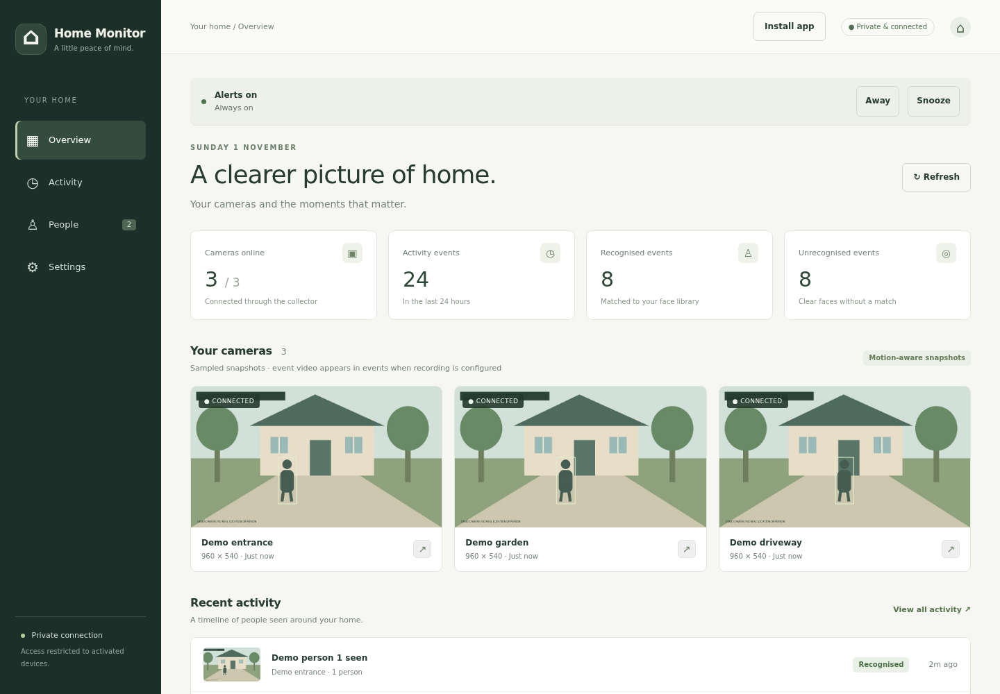
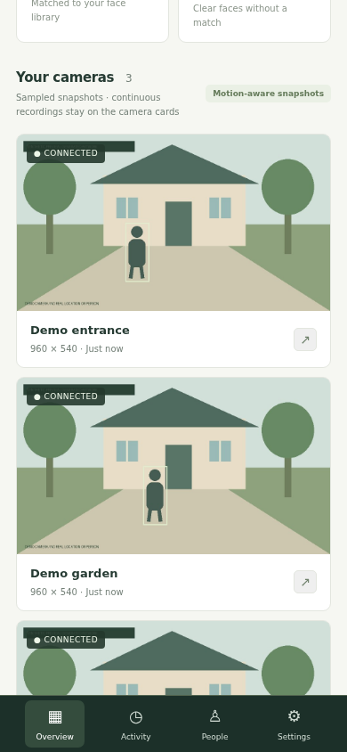
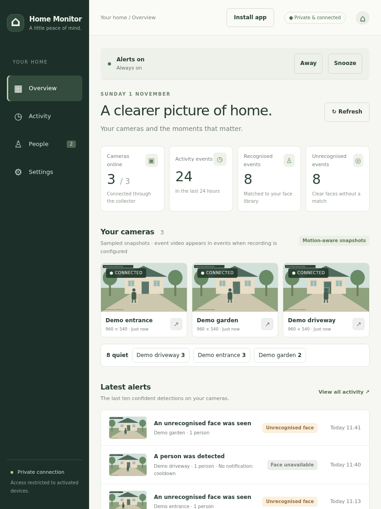
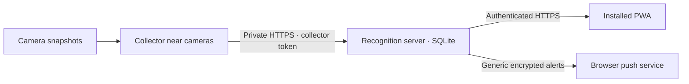

# Home Monitor

[](https://github.com/zandaulion/home-monitoring/actions/workflows/checks.yml)
[](LICENSE)

A self-hosted view of your cameras: selected snapshots, local person and face
recognition, a daily activity timeline, and optional device notifications.
Continuous video stays on the cameras' SD cards. Recognition runs on your own
server; no external inference service receives your images.



*The real interface with entirely synthetic events and code-generated artwork.
These previews show the interface, not recognition accuracy.*

| Phone · 390 × 844 | Tablet · 834 × 1112 |
| --- | --- |
|  |  |

[Activity timeline preview](docs/images/portfolio/activity.png) ·
[Try the local demo](#try-it-without-cameras) ·
[Install on two machines](deploy/README.md) ·
[Operations and privacy](docs/REFERENCE.md) ·
[Release guide](docs/RELEASING.md)

## What it does

- Samples authenticated camera snapshots near the camera network; uploads during
  movement and periodically, with no continuous recording on the server.
- Detects people and faces on CPU, with conservative matching against a private
  face library. Unclear faces remain unidentified.
- Shows snapshots and recognition results in a responsive, installable PWA.
- Explores a day of activity by camera, recognition state, and time range, with
  capture coverage and alert snooze periods alongside the events.
- Works as a person detector when cameras cannot resolve faces: face recognition
  is a setting, and turning it off skips all face processing.
- Sends person alerts always, on a schedule, or when you are away (by button or by
  phones leaving the home network), plus alerts when a camera stops reporting.
- Records vehicles and animals that move, with optional alerts; parked vehicles
  stay quiet.
- Keeps up to five photos per event and leads with the clearest one.
- Uses device invitations and revocable access, plus generic encrypted Web Push
  alerts for unidentified people, including when no face is visible. Payloads
  contain no images or names.
- Bounds event retention by age and storage size; enrolled samples are managed
  separately. Private images and API responses stay out of the PWA's offline cache.



The collector needs Python and Pillow. The server uses Python 3.12, FastAPI,
SQLite, OpenCV and ONNX Runtime; it is designed for ARM64 CPUs without a GPU.
A shared constraints file pins the tested dependency resolution while keeping
collector installs limited to Pillow. Snapshot URLs and authentication support
depend on the camera. Public HTTPS
access uses a hardened Caddy listener and Cloudflare Tunnel; private owner and
collector access use Tailscale Serve. Public access is optional.

## Try it without cameras

```sh
python3.12 -m venv .venv
.venv/bin/python -m pip install -r requirements.txt
.venv/bin/python scripts/demo.py
```

Open **http://127.0.0.1:8870**. Stop with Ctrl+C. The demo creates a temporary
private directory, draws invented scenes and avatars, seeds example events, and
removes that directory on exit. It uses fake inference, reads no production
configuration, downloads no model weights, and sends no camera requests or push
messages. It binds only to loopback and is for local preview, not deployment.
Photo enrolment and notification registration are disabled in this preview.

## Install for real

Use the [server and collector installation guide](deploy/README.md). It covers
private configuration generation, downloaded-model checksums, user services,
collector cron fallback, HTTPS boundaries, upgrades and private backups.

```sh
# Server: after installing requirements.txt in a virtual environment
.venv/bin/python scripts/manage.py init server
# Edit .runtime/config.json privately, then:
.venv/bin/python scripts/download_models.py
.venv/bin/python scripts/manage.py doctor server
```

On the collector, install `requirements-collector.txt` and run
`python scripts/manage.py init collector`. Edit its private config with your
camera credentials and the server's collector token, then run
`python scripts/manage.py doctor collector`. Generated service files use the
actual checkout path and remain under `.runtime/` until you install them.
Existing configuration is never overwritten by `init`.

## Development and previews

```sh
.venv/bin/python -m pip install -r requirements-dev.txt
.venv/bin/python -m pytest -q
node tests/push-worker.mjs
node tests/activity-timeline.mjs
# Chromium is needed only for browser previews and smoke checks:
.venv/bin/python -m playwright install chromium
.venv/bin/python scripts/screenshots.py
```

The screenshot command uses the isolated demo, blocks external browser requests,
checks browser errors and horizontal overflow, and writes four previews plus a
hash manifest. Run it from a machine that can launch Chromium and bind loopback
ports. Use the [development guide](CONTRIBUTING.md) for the publication checks.

## Reusing this finishing workflow

The portable [project-polish skill](skills/project-polish/SKILL.md) captures this
workflow for future projects: presentation, isolated synthetic demos, safe setup,
CI, curated releases, and exact-content privacy review. Install its folder in
your Codex skills directory and invoke `$project-polish` on another project.

## Privacy, limits, and support

Recognition is an estimate. This system does not provide liveness detection,
guaranteed identification, or tracking of a person across cameras. Verify
unexpected matches. Enrol consenting people and keep their data private.
Invited devices currently have full app access, including face-library editing.

Git and release archives contain code, synthetic templates, and generated
preview images. They are not backups of your installation. Preserve configuration,
SQLite data, images and the VAPID key in separate private backups.

Report reproducible bugs with synthetic examples. Never attach camera images,
face samples, database files, credentials, real addresses or device identifiers.
For vulnerabilities, follow [SECURITY.md](SECURITY.md).

Original code, documentation and generated preview artwork are
**GPL-3.0-or-later**; see [LICENSE](LICENSE). Vendored PWA helpers and downloaded
models retain their applicable notices; see [THIRD_PARTY_NOTICES.md](THIRD_PARTY_NOTICES.md).
